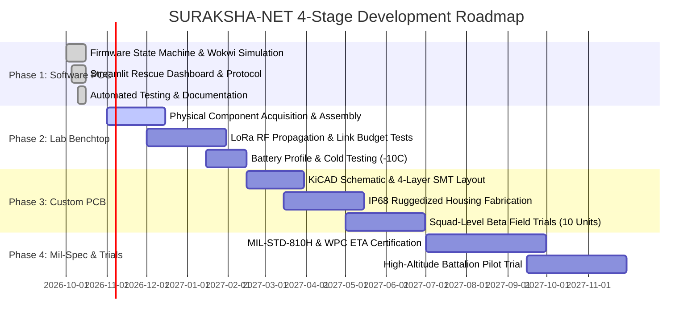

# SURAKSHA-NET: Staged Development Roadmap & Milestones

---

## Stage Breakdown & Gate Reviews

### Phase 1: Zero-Cost Software Simulation Proof-of-Concept [CURRENT STAGE]
- **Duration**: Completed
- **Expenditure**: **₹0** (Zero upfront capital expenditure)
- **Key Deliverables**:
  - Validated Wokwi circuit models (`wokwi/wearable/`, `wokwi/rescue_receiver/`).
  - Production-ready Arduino C++ firmware for Wearable, Relay, and Receiver nodes.
  - Interactive Streamlit command dashboard with geospatial tactical map.
  - Comprehensive automated test suite (`simulation/test_scenarios.py`) with 100% pass rate.
- **Go/No-Go Decision Gate**: Complete software simulation verification, sponsor proposal sign-off.

---

### Phase 2: Breadboard & Benchtop Lab Integration
- **Duration**: Months 1 – 3
- **Estimated Budget**: **₹50,000**
- **Key Deliverables**:
  - 3x physical ESP32 development breadboards with breakout sensors (MPU6050, DHT22, SSD1306).
  - 2x SX1278 physical LoRa transceivers operating on 866 MHz license-exempt Indian band.
  - Open-field ground-to-ground line-of-sight RF range measurements (target: $\ge 2.5\text{ km}$).
  - Battery discharge profiling under continuous transmission loads.
- **Risk Gate**: Successful reception of 99% of packets across a 2.0 km line-of-sight rural test link.

---

### Phase 3: Custom PCB & Field Ruggedization
- **Duration**: Months 4 – 7
- **Estimated Budget**: **₹2,50,000**
- **Key Deliverables**:
  - Custom 4-layer surface-mount (SMT) rigid-flex PCB designed in KiCad.
  - Integration of military-grade push-pull connectors and Molle-compatible clips.
  - Weatherproof, shock-absorbing IP68 silicone-gasketed enclosure (3D printed and CNC milled).
  - Environmental chamber testing across $-20^\circ\text{C}$ to $+55^\circ\text{C}$.
  - Deployment of 10 prototype units for tactical squad exercises with local civil defense or NCC units.
- **Risk Gate**: Node survival following a 2-meter drop onto concrete and 30-minute water immersion at 1 meter.

---

### Phase 4: Mil-Spec Certification & Institutional Pilot Trials
- **Duration**: Months 8 – 12
- **Estimated Budget**: **₹12,00,000 – ₹15,00,000**
- **Key Deliverables**:
  - **MIL-STD-810H Compliance**: Independent lab testing for ballistic shock, vibration, dust, sand, and thermal shock.
  - **Regulatory Certification**: Equipment Type Approval (ETA) from WPC / Department of Telecommunications, India.
  - **Armed Forces Pilot Trial**: Formal evaluation deployment with Indian Army / CAPF high-altitude mountain warfare school.
- **Commercial Milestone**: Transition to defense procurement licensing or serial contract manufacturing.
