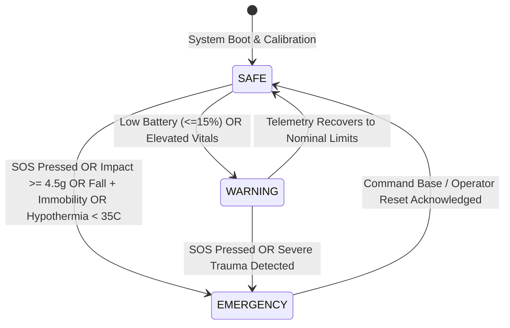

# SURAKSHA-NET: Emergency Triage Logic & State Machine

## 1. Overview & Triage Philosophy
The SURAKSHA-NET firmware operates an autonomous, edge-resident multi-sensor state machine. Its primary mission is to detect catastrophic combat injuries and environmental incapacitation in real time while vigorously filtering out false alarms caused by routine tactical movements (sprinting, crawling, jumping into trenches, or prone firing positions).

---

## 2. Quantitative Threshold Matrix (Unvalidated Estimates)

> [!CAUTION]
> **UNVALIDATED THRESHOLDS**:
> The values tabulated below represent initial engineering approximations derived from clinical trauma literature and automotive crash testing. They have **NOT** been certified in military live-fire, ballistic shock, or human trials.

| Parameter | Nominal Range | Warning Threshold | Emergency Threshold | Sensor Source |
| :--- | :--- | :--- | :--- | :--- |
| **Peak Impact Acceleration**| $0.8g - 2.0g$ | $2.5g - 4.4g$ | $\ge 4.5g$ (Blast / Crash) | MPU-6050 Accelerometer |
| **Freefall Duration** | None | N/A | $< 0.4g$ for $\ge 300\text{ms}$ | MPU-6050 Accelerometer |
| **Post-Impact Immobility** | Active movement | $\le 5\text{s}$ stillness | $> 10\text{s}$ total stillness | MPU-6050 Gyroscope Variance |
| **Core / Body Temperature** | $36.2^\circ\text{C} - 37.5^\circ\text{C}$ | $< 35.5^\circ\text{C}$ / $> 38.0^\circ\text{C}$ | $< 35.0^\circ\text{C}$ (Hypo) / $> 39.5^\circ\text{C}$ (Heat) | DHT22 / DS18B20 |
| **Heart Rate** | $55 - 110\text{ bpm}$ | $111 - 150\text{ bpm}$ | $< 45\text{ bpm}$ / $> 160\text{ bpm}$ | MAX30102 (Simulated) |
| **Oxygen Saturation ($SpO_2$)**| $95\% - 100\%$ | $89\% - 94\%$ | $< 88\%$ (Severe Hypoxia) | MAX30102 (Simulated) |
| **Battery Level** | $21\% - 100\%$ | $\le 20\%$ | $\le 10\%$ (Critical Depletion) | Battery ADC Divider |

---

## 3. Mathematical Formulations & Detection Algorithms

### 3.1 Kinematic Impact Vector Magnitude
Total instantaneous acceleration magnitude is computed by taking the Euclidean norm of all three orthogonal axes:
$$a_{\text{total}} = \sqrt{a_x^2 + a_y^2 + a_z^2}$$
Where $a_x, a_y, a_z$ are measured in units of gravitational acceleration ($g = 9.80665\text{ m/s}^2$).
- If $a_{\text{total}} \ge 4.5g$, an **`IMPACT_CRITICAL`** condition is immediately registered.

### 3.2 Two-Stage Fall & Immobility Detection
To differentiate an intentional tactical dive into cover from an incapacitating fall or collapse:
1. **Stage 1 (Freefall Phase)**: The acceleration vector drops below threshold:
   $$a_{\text{total}} < 0.4g \quad \text{for duration } \Delta t_1 \ge 300\text{ ms}$$
2. **Stage 2 (Impact Shock Phase)**: Freefall is immediately followed within $800\text{ ms}$ by an impact:
   $$a_{\text{total}} \ge 3.0g$$
3. **Stage 3 (Post-Impact Immobility Assessment)**: Angular velocity variance across gyroscope axes ($\omega_x, \omega_y, \omega_z$) is evaluated over a 10-second rolling window:
   $$\sigma_\omega^2 = \frac{1}{N}\sum_{i=1}^N \left( \omega_i - \bar{\omega} \right)^2 < 0.05\text{ rad}^2/\text{s}^2$$
If all three stages are satisfied, the node triggers **`FALL_DETECTED`** emergency.

---

## 4. False-Alarm Rejection & Soldier Cancellation Window

### The 10-Second Haptic Pre-Alarm Grace Period
A frequent issue in tactical military systems is soldiers accidentally triggering alerts when jumping into trenches or dropping heavy rucksacks. To prevent unnecessary rescue dispatches:
1. When an automatic impact or fall trigger occurs, the node does **not** instantly blast the tactical RF channel.
2. The unit enters a **10-second local pre-alarm phase**:
   - The haptic vibration motor pulses violently against the soldier's wrist/chest.
   - The OLED display renders: `[FALL DETECTED - PRESS SOS TO CANCEL]`.
3. If the soldier is conscious and unharmed, they simply tap the SOS switch once during this 10-second window. The event is logged as `TACTICAL_JUMP_FALSE_ALARM` and no emergency distress beacon is transmitted to the base.
4. If the soldier is unconscious and fails to press the cancel button within 10 seconds, the system promotes the event to a full **`EMERGENCY`** distress beacon.
