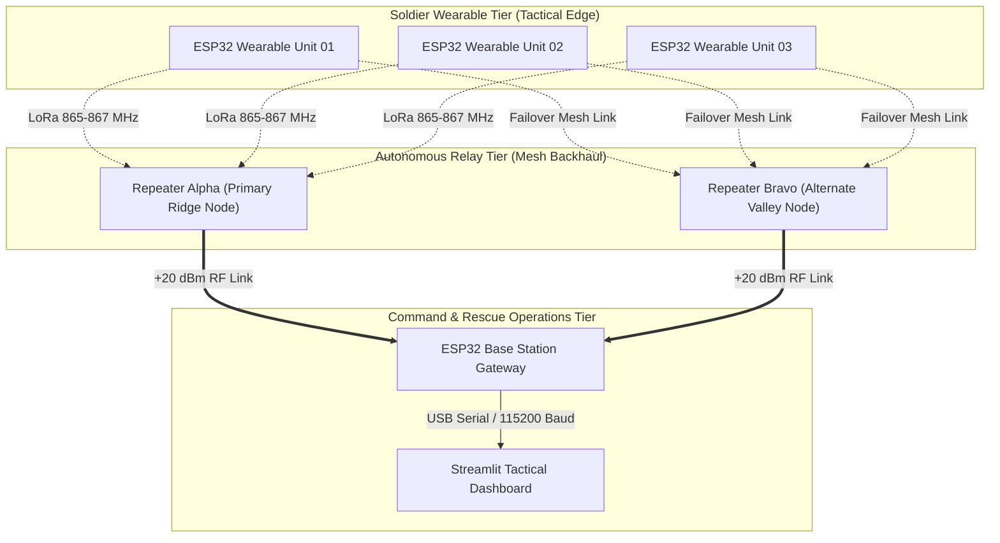

# SURAKSHA-NET: Proposed Solution & System Design

## 1. Core Engineering Philosophy
The SURAKSHA-NET architecture is founded on four foundational engineering principles designed specifically for contested, forward military operating theaters:

1. **Edge-First Autonomous Triage**: Emergency determination must execute locally on the wearable microcontroller (ESP32) within milliseconds. The system never depends on an active internet connection, cloud API, or centralized server to decide whether a soldier is in critical danger.
2. **Multi-Sensor Fusion & False-Alarm Rejection**: Single-sensor alerts (e.g., high acceleration alone during a tactical dive) frequently cause false alarms. SURAKSHA-NET cross-correlates kinetic impact ($>4.5g$), post-impact immobility (derived from gyroscope variance), and physiological distress (tachycardia or desaturation) before declaring a critical casualty.
3. **RF Silence & Asymmetric Transmission**: During routine patrols, transmissions are restricted to low-power, periodic telemetry heartbeats (every 3000ms–5000ms) to minimize RF energy and prevent detection by enemy Electronic Support Measures (ESM). When a casualty event occurs, the node shifts to high-rate, maximum-power burst beaconing (every 750ms).
4. **Self-Healing Decentralized Mesh Topology**: Mountain folds and deep river valleys block point-to-point line-of-sight RF. Autonomous, solar-buffered relay nodes repeat signals across ridgelines with built-in deduplication and dynamic path failover.

---

## 2. Multi-Tier System Hierarchy

### Tier 1: Soldier Wearable Tactical Unit
- **Form Factor**: Molle-compatible chest harness or tactical wrist pack.
- **Microcontroller**: Dual-core 32-bit Xtensa LX6 (ESP32) running FreeRTOS.
- **Biomechanical Sensing**: MPU-6050 6-DOF IMU configured for $\pm 16g$ impact capture and orientation tracking.
- **Physiological Sensing**: Ambient and body surface temperature sensor (DHT22 / DS18B20); optional/simulated optical pulse oximeter (MAX30102).
- **Soldier Interface**: Recessed tactile push-button for immediate manual SOS activation; high-contrast 0.96" OLED display for local tactical status; vibrating coin motor for silent haptic alerts.

### Tier 2: Autonomous Tactical Relay Node
- **Form Factor**: Ruggedized, pole-mounted weatherproof enclosure (IP67).
- **Deployment**: Placed at high elevation points (ridge peaks, trees, observation posts, or tethered drones).
- **Deduplication Engine**: Software ring buffer tracking the last 32 message IDs to eliminate RF broadcast storms.
- **Dynamic Failover**: If a primary relay is destroyed, jammed, or depleted of battery, downstream wearables and intermediate nodes automatically route through secondary relays.

### Tier 3: Tactical Operating Base (TOB) Gateway
- **Hardware**: ESP32 base station receiver connected to a directional antenna array.
- **Local Alerting**: Dual-tone piezoelectric alarm siren and flashing red casualty strobe to alert base personnel immediately without requiring screen monitoring.
- **Hardware Acknowledge**: Tactile push button on the receiver console allowing the command operator to acknowledge and mute audio sirens during an active rescue dispatch.

### Tier 4: Tactical Command & Rescue Operations Dashboard
- **Implementation**: Python 3.12, Streamlit, Pandas, and Altair.
- **Capabilities**:
  - Real-time squad status cards with dynamic color coding (`SAFE` = Green, `WARNING` = Amber, `EMERGENCY` = Pulsing Red).
  - Tactical GIS geospatial map pinpointing casualty coordinates, altitude, and repeater locations.
  - Interactive event injection console to simulate blast impacts, falls, hypothermia, and relay node failures.
  - Auditable mission event log with CSV/JSON export capability.

---

## 3. Comparative Advantage Over Legacy Systems

| Feature | Legacy Voice Radio (CNR) | Commercial Smartwatches | SURAKSHA-NET |
| :--- | :--- | :--- | :--- |
| **Autonomous Operation** | None (Requires conscious manual PTT) | Limited to fall detection | **Full Multi-Sensor Autonomous Triage** |
| **Cellular Dependency** | None (Direct RF) | Mandatory (Requires 4G/LTE towers) | **Zero Cloud/Cellular Dependency (Self-Contained RF)** |
| **RF Intercept Risk** | High (Continuous high-power voice) | Low (Short-range Bluetooth) | **Low (Sub-second burst LoRa packets, LPI)** |
| **Mountain Coverage** | Degrades in mountain shadow | Fails outside cell coverage | **Autonomous Ridgeline Relay Mesh** |
| **Unit Hardware Cost**| High (₹1,50,000–₹5,00,000) | Moderate (₹15,000–₹40,000) | **Ultra-Low Cost (~₹3,200 per wearable)** |
