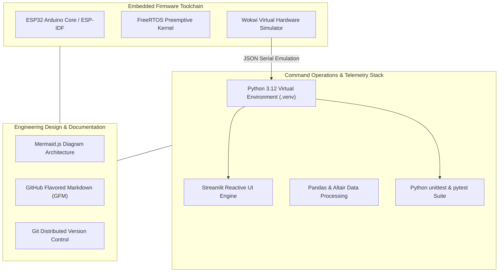

# SURAKSHA-NET: Software Stack & Toolchain Justification

## 1. Overview & Architectural Stack
To realize a **zero-cost, air-gapped, simulation-first proof of concept**, SURAKSHA-NET utilizes an entirely open-source, locally executable software toolchain. No paid API keys, proprietary vendor lock-in, or mandatory external cloud services are required.

---

## 2. Toolchain Breakdown & Technical Justifications

### 2.1 Microcontroller Framework: ESP32 Arduino Core & FreeRTOS
- **Why ESP32**: The Espressif ESP32 provides a dual-core 32-bit Xtensa LX6 architecture running up to 240 MHz. One core is dedicated to low-level sensor sampling (IMU shock polling at 100 Hz), while the secondary core handles RF packet serialization and telemetry state machines.
- **Why Arduino Core over Pure Register ESP-IDF**: Accelerated prototyping velocity, extensive library driver support (Adafruit GFX, ArduinoJson, LoRa), and seamless portability into browser-based simulation platforms like Wokwi.

### 2.2 Electronics Simulation: Wokwi Simulator
- **Zero Cost & High Accessibility**: Wokwi eliminates the need for expensive physical prototype fabrication during early conceptual development. Sponsors and reviewers can launch and interact with the complete circuit in any modern web browser without purchasing hardware.
- **Cycle-Accurate Peripheral Emulation**: Emulates the ESP32 CPU, I2C bus transactions, GPIO interrupts, PWM timers, and SPI communications with realistic cycle accuracy.
- **Standardized Part Descriptors**: Uses transparent `diagram.json` syntax to map exact virtual components (`board-esp32-devkit-v1`, `chip-mpu6050`, `board-ssd1306`, `sensor-dht22`, `wokwi-pushbutton`, `wokwi-led`, `wokwi-buzzer`).

### 2.3 Command Dashboard: Python 3.12 & Streamlit
- **Air-Gapped Local Execution**: Runs locally on standard tactical military laptops (e.g., Panasonic Toughbook) without requiring internet or cellular connectivity.
- **Rapid Reactive Rendering**: Streamlit's stateful execution model enables real-time updates of soldier vitals, geospatial coordinates, and alert status cards with sub-100ms latency.
- **Data Manipulation**: Built-in Pandas integration enables real-time filtering, metric computation, and instant export of incident telemetry logs into CSV or JSON formats for post-mission debriefing.

### 2.4 Data Serialization: JSON (with Future CBOR/Protobuf Roadmap)
- **Human-Readable Proof of Concept**: Standardized JSON telemetry packets ensure effortless debugging, automated unit test verification, and seamless bridging across Serial, WebSockets, and dashboard components.
- **Bandwidth Optimization Pathway**: While JSON is ideal for proof-of-concept simulation, the production roadmap specifies binary serialization (CBOR or Protocol Buffers) to compress telemetry payloads from ~450 bytes down to ~38 bytes, preserving RF airtime on 125 kHz LoRa channels.

### 2.5 Verification & Quality Assurance: Python unittest & pytest
- Provides deterministic automated regression testing for:
  1. Multi-sensor emergency state machine transitions.
  2. Protocol parsing and CRC checksum integrity.
  3. Physical bounds validation (rejecting corrupted or impossible vitals).
  4. Network mesh failover and dynamic rerouting.
  5. In-memory duplicate frame suppression.
