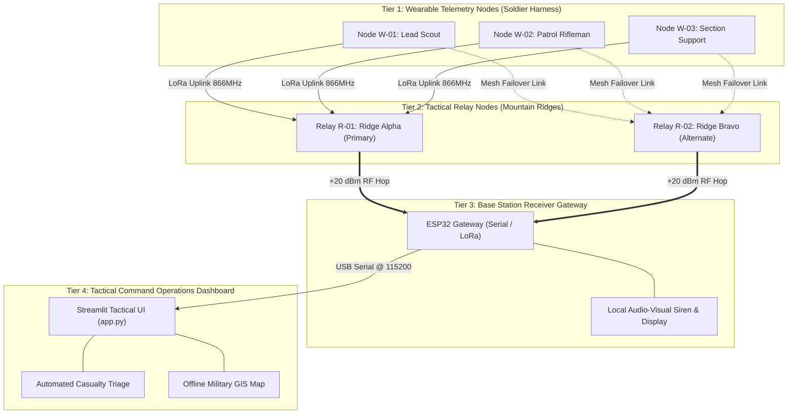

# SURAKSHA-NET: System Architecture & Hardware Engineering Guide

## 1. Architectural Overview
SURAKSHA-NET is structured into four functional tiers that bridge tactical edge computing on the soldier with long-range decentralized communications and operational command centers.

---

## 2. Hardware Wiring & Pin Mapping Reference

### 2.1 Soldier Wearable Unit (ESP32 DevKit V1)
| Peripheral | Pin / Bus | ESP32 GPIO | Operating Voltage | Pullup / Resistor | Purpose |
| :--- | :--- | :--- | :--- | :--- | :--- |
| **MPU-6050 IMU** | SDA | GPIO 21 | 3.3V | Internal / 4.7kΩ | I2C Data (Acceleration/Gyro) |
| | SCL | GPIO 22 | 3.3V | Internal / 4.7kΩ | I2C Clock |
| **SSD1306 OLED** | SDA | GPIO 21 | 3.3V | Shared Bus | I2C Data |
| | SCL | GPIO 22 | 3.3V | Shared Bus | I2C Clock |
| **DHT22 / Temp** | DATA | GPIO 15 | 3.3V | 10kΩ Pullup to 3.3V | Single-Wire Thermal Telemetry |
| **SOS Pushbutton** | Contact | GPIO 2 | 3.3V | Internal Pullup | Active-LOW Tactile Emergency Trigger |
| **Alert LED** | Anode (+) | GPIO 4 | 3.3V | 220Ω Current Limiter | Visual Emergency Strobe |
| **Haptic Motor** | Gate | GPIO 13 | 3.3V | 10kΩ Gate Pulldown | MOSFET Drive for 3V Coin Motor |
| **SX1278 LoRa (Opt)**| SCK / MISO / MOSI | 18 / 19 / 23 | 3.3V | N/A | Hardware SPI Master Bus |
| | NSS / RST / DIO0 | 5 / 14 / 26 | 3.3V | N/A | Chip Select, Reset, Rx/Tx Interrupt |

### 2.2 Tactical Relay Node (ESP32-WROOM-32)
| Peripheral | Pin / Bus | ESP32 GPIO | Operating Voltage | Purpose |
| :--- | :--- | :--- | :--- | :--- |
| **SX1278 LoRa** | SCK / MISO / MOSI | 18 / 19 / 23 | 3.3V | SPI Bus for High-Power RF Transceiver |
| | NSS / RST / DIO0 | 5 / 14 / 26 | 3.3V | SPI CS, Reset, Radio Interrupt |
| **Status LEDs** | Heartbeat | GPIO 2 | 3.3V | Blue LED: Node Power & Health Pulse |
| | Forwarding | GPIO 4 | 3.3V | Yellow LED: Telemetry Hop Forwarded |
| | Fault / Low Bat | GPIO 15 | 3.3V | Red LED: Battery Low or Jamming Alert |

### 2.3 Base Station Gateway Receiver
| Peripheral | Pin / Bus | ESP32 GPIO | Operating Voltage | Purpose |
| :--- | :--- | :--- | :--- | :--- |
| **SSD1306 OLED** | SDA / SCL | GPIO 21 / 22 | 3.3V | I2C Display for Base Personnel |
| **Acoustic Siren** | Positive (+) | GPIO 15 | 3.3V via Transistor | 90dB Casualty Alert Siren |
| **Casualty Strobe** | Anode (+) | GPIO 4 | 3.3V via 220Ω | High-Intensity Red LED Flasher |
| **Acknowledge Btn** | Contact | GPIO 14 | 3.3V (Pullup) | Operator Alarm Mute Switch |

---

## 3. Power Budget & Battery Endurance Calculation

### 3.1 Wearable Node Current Profile (3.7V LiPo 1200mAh)
- **ESP32 Dual-Core Active**: ~55 mA
- **MPU6050 + SSD1306 (Active Display)**: ~15 mA
- **DHT22 + Peripheral Standby**: ~2.5 mA
- **LoRa SX1278 Receive Mode**: ~12 mA
- **LoRa SX1278 Transmit Mode (+17 dBm Burst for 80ms)**: ~100 mA
- **Haptic Motor Pulse (Emergency Mode only)**: ~60 mA

#### Nominal Operating Mode (SAFE State):
- 1 transmission burst of 80ms every 3000ms ($2.67\%$ duty cycle).
- Average continuous current draw:
  $$I_{\text{avg}} = 55\text{ mA} + 15\text{ mA} + 2.5\text{ mA} + (0.0267 \times 100\text{ mA}) \approx 75.2\text{ mA}$$
- Expected battery endurance on a standard 1200mAh LiPo cell:
  $$T_{\text{nominal}} = \frac{1200\text{ mAh} \times 0.85\text{ (efficiency)}}{75.2\text{ mA}} \approx 13.5\text{ Hours}$$

#### Emergency Mode (EMERGENCY State):
- Strobe LED active, haptic motor pulsing, transmission burst every 750ms ($10.6\%$ duty cycle).
- Average current draw: $\approx 145\text{ mA}$.
- Expected battery endurance during emergency beaconing:
  $$T_{\text{emergency}} = \frac{1200\text{ mAh} \times 0.85}{145\text{ mA}} \approx 7.0\text{ Hours}$$

---

## 4. RF Link Budget & Mountain Propagation
- **Frequency Band**: 865–867 MHz (Wireless Planning & Coordination / WPC license-exempt band in India).
- **Transmit Power**: +17 dBm (Wearable), +20 dBm (Relay Node).
- **Receiver Sensitivity**: $-137\text{ dBm}$ (LoRa SF10, 125 kHz BW).
- **Total Link Budget**:
  $$\text{Link Budget} = P_{\text{tx}} - S_{\text{rx}} = 20\text{ dBm} - (-137\text{ dBm}) = 157\text{ dB}$$
- **Terrain Considerations**: In Himalayan and jagged ridge topography, direct line-of-sight is obstructed by mountain folds (knife-edge diffraction loss typically $15\text{ dB}$ to $30\text{ dB}$). The deployment of ridgeline relay nodes restores line-of-sight geometry, extending reliable squad reach up to **8–12 kilometers**.
