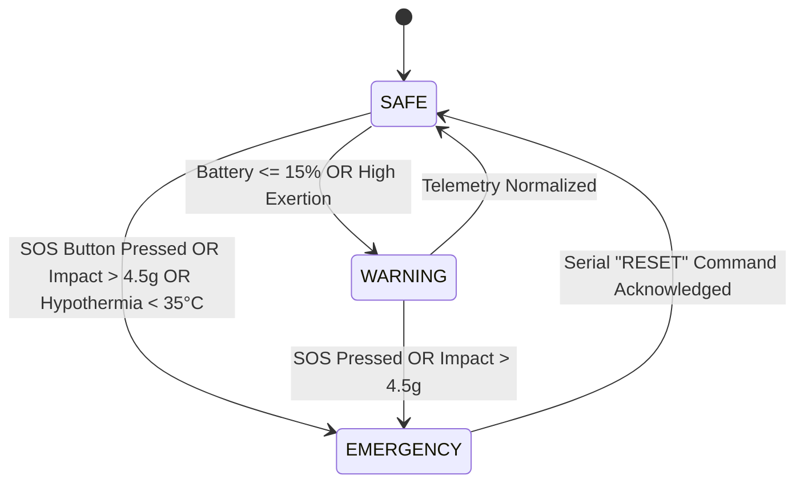

# SURAKSHA-NET: Soldier Wearable Node Firmware

## Overview
The Soldier Wearable Node is an ESP32-based biometric and kinematics telemetry unit designed for field deployment on combat vests or wrist harnesses. It performs on-node sensor fusion, local emergency triage, visual/haptic alerting, and long-range telemetry broadcasting.

> [!WARNING]
> **SIMULATION-FIRST PROOF OF CONCEPT**:
> Thresholds such as 4.5g impact, 35.0°C hypothermia, and physiological vitals are engineering approximations. They have NOT undergone ballistic, explosion, or clinical testing.

---

## Hardware Pinout & Wiring Table

| Component | Pin / Bus | ESP32 GPIO | Operating Voltage | Function |
| :--- | :--- | :--- | :--- | :--- |
| **MPU-6050 IMU** | SDA | GPIO 21 | 3.3V | I2C Data (Acceleration & Gyro) |
| | SCL | GPIO 22 | 3.3V | I2C Clock |
| | VCC / GND | 3V3 / GND | 3.3V | Power Rail |
| **SSD1306 OLED** | SDA | GPIO 21 | 3.3V | I2C Data (Shared with IMU) |
| | SCL | GPIO 22 | 3.3V | I2C Clock |
| | VCC / GND | 3V3 / GND | 3.3V | Power Rail |
| **DHT22 / Temp** | DATA | GPIO 15 | 3.3V | Single-Wire Bus for ambient/core temp |
| **SOS Pushbutton** | PIN 1 | GPIO 2 | 3.3V (Pullup) | Active-LOW emergency trigger |
| | PIN 2 | GND | Ground | Ground return |
| **Alert LED** | Anode (+) | GPIO 4 | 3.3V via 220Ω | Visual warning/emergency strobe |
| **Vibration / Buzzer** | Gate / Trigger | GPIO 13 | 3.3V / 5V rail | Haptic emergency vibration |
| **SX1278 LoRa (Opt)**| SCK / MISO / MOSI | 18 / 19 / 23 | 3.3V | SPI Bus for long-range RF |
| | NSS / RST / DIO0 | 5 / 14 / 26 | 3.3V | Chip Select, Reset, Interrupt |

---

## Required Libraries
When compiling in the Arduino IDE or PlatformIO, install:
1. `Adafruit MPU6050`
2. `Adafruit SSD1306` & `Adafruit GFX Library`
3. `DHT sensor library for ESPx`
4. `ArduinoJson` (v6.x or v7.x)
5. `LoRa` (Sandeep Mistry, optional for physical radio)

---

## State Machine

